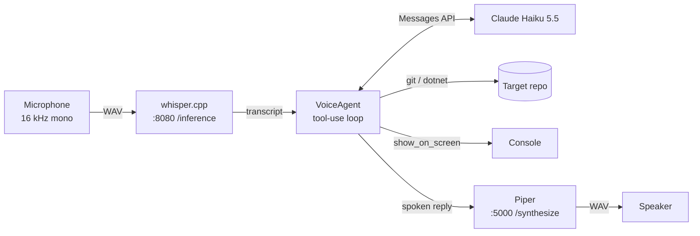

# Architecture

`dotnet-voice-dev-agent` is a single .NET 10 console app (`src/VoiceDevAgent`) plus two local HTTP services
started with Docker. It turns one spoken request into one spoken reply, using Claude with read-only tools that
inspect a target .NET repository.

## Overview

| Component | File | Role |
|---|---|---|
| Session loop | `Program.cs` | Startup checks, push-to-talk, barge-in, error handling for each stage |
| Agent | `VoiceAgent.cs` | Conversation history, tool-use loop, system prompt, spoken-length guard |
| Tools | `DevTools.cs` | `git status`, `dotnet build` and `dotnet test`, each condensed for the model; process runner |
| Speech clients | `Speech.cs` | HTTP clients for whisper-server and Piper |
| Audio | `Audio.cs` | PortAudio capture and playback, WAV encode/decode |
| STT service | `docker-compose.yml` | whisper.cpp image pinned by commit, model mounted from `models/` |
| TTS service | `piper/Dockerfile` | Piper HTTP server with the voice baked into the image |

Both services listen only on `127.0.0.1`. Their addresses are hard-coded in `Program.cs`.

## One turn, end to end

1. **Startup** (once). With no repository argument the app exits with code 2. It exits with code 1 if
   `ANTHROPIC_API_KEY` is unset. Then PortAudio is initialized and the default devices are checked: voice mode
   needs a microphone, and without speakers the replies are only printed. Last, it checks only the containers
   the session will call, and exits with code 1 if one doesn't answer: it synthesizes "ready" if there is an
   output device and, in voice mode, transcribes half a second of silence.
2. **Capture.** Enter starts a PortAudio input stream, and the next Enter stops it. The audio callback only
   copies samples into an unbounded `Channel`, so it never blocks the audio thread. The samples become a WAV in
   Whisper's own format (16 kHz, mono, 16-bit), so nothing is resampled.
3. **Transcribe.** `WhisperClient` posts the WAV along with `Vocabulary` as the initial prompt (spelling hints for
   project jargon), language `en` and temperature 0. The transcript is always printed as `heard: "..."`.
4. **Think.** `VoiceAgent.AskAsync` runs the tool-use loop (next section). Tool calls run against the target
   repository, and `show_on_screen` text is printed in a box.
5. **Speak.** The final text goes to Piper. While it plays, Enter cancels playback (`Stream.Abort` drops the
   buffered audio). Whether Enter cut playback off or came after it ended, the same press starts the next
   recording.

In `--text` mode, steps 2–3 are replaced by `Console.ReadLine`, and playback can't be interrupted.

## The tool-use loop (`VoiceAgent`)

- Model `claude-haiku-5-5`, `Effort.Low`, `MaxTokens` 4096. The system prompt and, with a top-level
  `cache_control`, the conversation so far are cached, so each step of a turn reads the history from cache.
- **The system prompt is frozen for the session.** It is built once in the constructor: the base prompt, the
  memory rules, and a second block with the memory as it was when the session started. Memory written during
  the session goes to disk and appears in the next session's prompt. Changing `system` mid-session would
  discard the cache and, on Haiku 5.5, invalidate every thinking block already in the history.
- **The history only grows at the end.** The session date goes in the session's first user message, not in the
  system prompt, so a history carried over from an earlier day is still a prefix of the next request.
- At most **8 steps** per turn. In each step, every `tool_use` block runs in order, and all `tool_result`s go
  back in **one** user message. A response without tool calls ends the turn.
- **Every block is echoed back unchanged**, including thinking and redacted thinking blocks, because the API
  validates the history.
- **Atomic turns.** `AskAsync` records where the turn starts in `messages`. If anything throws, or the step limit
  runs out, the whole turn is removed. The history therefore never ends with a `tool_use` that has no
  `tool_result`, which would make every later request fail.
- **Blank input.** `IsBlank` removes Whisper's bracketed or parenthesized markers (`[BLANK_AUDIO]`,
  `(silence)`). If nothing is left, the turn is skipped before any API call.
- **Refusals.** `stop_reason == "refusal"` raises `RefusalException`. The session answers "I can't help with
  that one."
- **Never silent.** A turn can end on a tool call with no text. Spoken, that is silence, so `AskAsync` returns
  "Details are on screen." when the turn showed something, and "Okay." otherwise.

### Two output channels

The reply is heard, so it has to be short. The system prompt asks for at most two sentences and no paths or
identifiers. Anything precise goes through the `show_on_screen` tool instead. Prompts don't guarantee length, so
`GuardSpoken` enforces it in code: a reply over `MaxSpokenWords` (30, about ten seconds of Piper speech) is
printed in full, and only its first sentence is spoken, followed by "The rest is on screen."

## Tools (`DevTools`)

All tools are **read-only**, so a misheard request can at worst start a build. Each tool reduces raw process
output to what the model needs:

| Tool | Command | What the model gets |
|---|---|---|
| `git_status` | `git status --porcelain=v2 --branch` | Branch, ahead/behind, up to 40 changed files (renames included) and 20 untracked |
| `dotnet_build` | `dotnet build --nologo [project]` | Diagnostics deduplicated (MSBuild prints each one twice), errors first, at most 50, paths relative to the repo |
| `dotnet_test` | `dotnet test --logger trx` into a temp directory | Pass/fail counts and up to 15 failures with their message and up to 3 frames outside `System.*` |
| `read_file` | none (reads the file) | Up to 200 numbered lines of one file inside the repository. Refused: `.git`, `.env*` and `*.env`, key files and common private-key names, any path through a link or junction, 8.3 short names (`GIT~1`), binaries, files over 1 MB. A denylist, so not complete |
| `show_on_screen` | none | Prints the text and returns `Shown.` |
| `memory` | none (`MemoryStore`) | Claude's memory tool (`memory_20250818`): `view`, `create`, `str_replace`, `insert`, `delete`, `rename` under `/memories` |

`DevTools.RunAsync` is the only place that starts a process:

- Arguments go through `ProcessStartInfo.ArgumentList`. A command string is never built from model input.
- `ArgumentList` stops shell injection, not option injection, so model-supplied values are validated before
  they get here. `ResolveProject` accepts `dotnet_build`'s `project` only if it doesn't start with `-`,
  resolves inside the repository, has a project or solution extension and exists. It passes on the full path;
  a refusal goes back to the model as an `is_error` result.
- `MSBuild*` environment variables are removed. `dotnet run` exports them for the SDK that built the agent, and
  without this a child build would ignore the target repository's `global.json`.
- stdout and stderr are combined, there is a **5-minute** timeout, and the whole process tree is killed when it
  expires.
- **The exit code is the verdict.** A failed build with no parsed diagnostics is still reported as a failure,
  along with the last 10 output lines.

## Memory (`MemoryStore`)

Claude's memory tool is client-side: the model sends file commands against a virtual `/memories` directory and
`MemoryStore` runs them on a real folder, one per repository, under `LocalApplicationData/VoiceDevAgent/memories`
(named after the repository folder plus 8 hex digits of a SHA-256 of its full path). It is outside the
repository, so a memory is never committed. Every path and every line of text comes from the model:

- **Paths** must be `/memories` or start with `/memories/`. Parts that start with `.`, or contain `\`, `:`, `%`
  or NUL, are refused before `Path.GetFullPath`, and the resolved path must still be inside the folder.
- **Caps**: 4,000 characters per file, 6,000 in total. A write over either is refused with a message asking the
  model to merge or delete entries; the old file is kept.
- **Atomic writes** (temp file, then `File.Move` with overwrite) and an exclusive `.lock` file per command, so
  two sessions on the same repository can't interleave a `str_replace`.
- **No common credentials**: text matching common key formats (`sk-ant-`, `sk_live_`, `ghp_`, `github_pat_`,
  `xox?-`, `AKIA`, `AIza`, JWTs, PEM private keys, `Password=`/`Pwd=` in a connection string) is never written.
  It is a denylist, not a guarantee.
- **Durable writes**: the temp file is flushed to disk before the move; orphaned temp files from a crash are
  deleted when the store opens. A malformed `view_range` is an error result, not an exception.
- **Errors are tool results**, never exceptions: the model sometimes sends `old_path` where `path` belongs and
  retries after the error.

The memory is preloaded into the system prompt at session start ("You do not need to view it again"), because
the tool's own instruction otherwise makes the model spend two calls viewing it before every first answer. The
prompt tells the agent what to save (what tools can't tell it) and to verify a memory with a tool before acting
on it. In the Part 3 measurements, the agent saved build state anyway; the verify rule is what catches it.

## Error handling

The rule is that failures stay inside the conversation, and the session keeps running.

| Where | Failure | Result |
|---|---|---|
| Startup | No repo argument | Usage message, exit code 2 |
| Startup | No API key, containers down | Message, exit code 1 |
| Startup | PortAudio fails to initialize; no microphone in voice mode | Message, exit code 1 (the second suggests `--text`) |
| Startup | No speakers or headphones | Notice; replies are printed and Piper is not called |
| Recording | `AudioDeviceException` (busy, unplugged, unsupported rate) | Printed; the loop waits for the next request |
| Speech-to-text | HTTP error or timeout | Printed; the loop waits for the next request |
| Model | `AnthropicException`, HTTP error, timeout | Turn dropped from history; says "I couldn't reach the model…" |
| Model | Refusal | Turn dropped; says "I can't help with that one." |
| Model | 8 steps without a final answer | Turn dropped; says "I went in circles on that one…" |
| Tool | Timeout, missing executable (`Win32Exception`), I/O, bad input | Returned to the model as an `is_error` tool result |
| Text-to-speech | HTTP error or timeout | Printed; the reply is not spoken |
| Playback | `AudioDeviceException` | Printed; the reply is already on screen |

`Microphone` and `Speaker` report every device failure as `AudioDeviceException`: a missing default device, or
a `PortAudioException` from opening, starting or stopping a stream, wrapped. `AudioDevices.Detect` checks the
default devices once at startup. PortAudio lists devices only in `Initialize`, so a device plugged in during a
session is not seen until the next run. When voice-mode playback fails, the `Console.ReadLine` started for
barge-in is still awaited, so it can't swallow the next Enter.

## Audio details

- Callbacks run on PortAudio's real-time thread. Capture only writes to a channel. Playback copies from a
  preloaded array and fills the end of the last buffer with a preallocated silence buffer, so it doesn't
  allocate in the callback.
- `Stream.Stop()` blocks until the last capture callback has returned, so completing the channel afterwards
  is safe.
- `Wav.Decode` walks the RIFF chunks instead of assuming a 44-byte header. It accepts the `0xFFFFFFFF` size that
  streaming writers use and rejects anything that isn't 16-bit mono.

## Infrastructure

- **whisper.cpp** is pinned to an image tagged by commit (v1.9.5). Its entrypoint is `bash -c`, so the compose
  `command` must be a one-element list. A plain string is split into words, and every flag after
  `whisper-server` is silently dropped. CI checks this with `docker compose config | jq`.
- `WHISPER_MODEL` (default `tiny.en`) selects `models/ggml-<model>.bin`. Models are downloaded, not committed.
- **Piper** installs `piper-tts[http]==1.8.0` and downloads `en_US-lessac-medium` at build time, so the
  container starts offline.

## Tests

`tests/VoiceDevAgent.Tests` (xUnit) covers the pure logic only. Each tool is split into the code that starts the
process and a pure `Summarize*` function that condenses the output, so the parsing is tested with literal
`git`/MSBuild/TRX output. Audio, the containers and the Claude API are not covered by tests.

## Extension points

- **System prompt** (`VoiceAgent.SystemPrompt`): describes the repository the articles used (ClaudeReviewBot).
  Replace it with your own projects and rules.
- **Vocabulary** (`Program.cs`): Whisper's initial prompt. Add your type names, error codes and jargon.
- **New tool**: add a `Tool` to `VoiceAgent.Tools`, a `case` in `RunToolAsync`, and in `DevTools` a method that
  runs the process plus a pure `Summarize*` function with tests. If the tool has side effects, it must ask for confirmation in code, not in the prompt.
- **Language**: the `.en` Whisper models and the English Piper voice make the agent English only. Spanish needs
  a multilingual Whisper model, a Spanish Piper voice and a different `language` argument.
