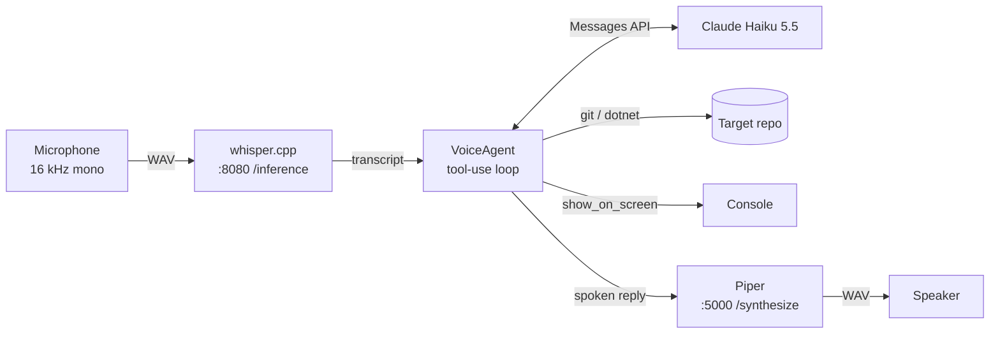

# Architecture

`dotnet-voice-dev-agent` is a single .NET 10 console app (`src/VoiceDevAgent`) plus two local HTTP services
started with Docker. It turns one spoken request into one spoken reply, using Claude with read-only tools that
inspect a target .NET repository.

## Overview

| Component | File | Role |
|---|---|---|
| Session loop | `Program.cs` | Startup checks, push-to-talk, barge-in, error handling for each stage |
| Agent | `VoiceAgent.cs` | Conversation history, tool-use loop, system prompt, spoken-length guard |
| Tools | `DevTools.cs` | `git status`, `dotnet build` and `dotnet test`, each condensed for the model; process runner |
| Speech clients | `Speech.cs` | HTTP clients for whisper-server and Piper |
| Audio | `Audio.cs` | PortAudio capture and playback, WAV encode/decode |
| STT service | `docker-compose.yml` | whisper.cpp image pinned by commit, model mounted from `models/` |
| TTS service | `piper/Dockerfile` | Piper HTTP server with the voice baked into the image |

Both services listen only on `127.0.0.1`. Their addresses are hard-coded in `Program.cs`.

## One turn, end to end

1. **Startup** (once). With no repository argument the app exits with code 2. It exits with code 1 if
   `ANTHROPIC_API_KEY` is unset or a container does not answer: it synthesizes "ready" and, in voice mode,
   transcribes half a second of silence.
2. **Capture.** Enter starts a PortAudio input stream, and the next Enter stops it. The audio callback only
   copies samples into an unbounded `Channel`, so it never blocks the audio thread. The samples become a WAV in
   Whisper's own format (16 kHz, mono, 16-bit), so nothing is resampled.
3. **Transcribe.** `WhisperClient` posts the WAV along with `Vocabulary` as the initial prompt (spelling hints for
   project jargon), language `en` and temperature 0. The transcript is always printed as `heard: "..."`.
4. **Think.** `VoiceAgent.AskAsync` runs the tool-use loop (next section). Tool calls run against the target
   repository, and `show_on_screen` text is printed in a box.
5. **Speak.** The final text goes to Piper. While it plays, Enter cancels playback (`Stream.Abort` drops the
   buffered audio). Whether Enter cut playback off or came after it ended, the same press starts the next
   recording.

In `--text` mode, steps 2–3 are replaced by `Console.ReadLine`, and playback can't be interrupted.

## The tool-use loop (`VoiceAgent`)

- Model `claude-haiku-5-5`, `Effort.Low`, `MaxTokens` 4096, and the system prompt marked for prompt caching.
- At most **8 steps** per turn. In each step, every `tool_use` block runs in order, and all `tool_result`s go
  back in **one** user message. A response without tool calls ends the turn.
- **Every block is echoed back unchanged**, including thinking and redacted thinking blocks, because the API
  validates the history.
- **Atomic turns.** `AskAsync` records where the turn starts in `messages`. If anything throws, or the step limit
  runs out, the whole turn is removed. The history therefore never ends with a `tool_use` that has no
  `tool_result`, which would make every later request fail.
- **Blank input.** `IsBlank` removes Whisper's bracketed or parenthesized markers (`[BLANK_AUDIO]`,
  `(silence)`). If nothing is left, the turn is skipped before any API call.
- **Refusals.** `stop_reason == "refusal"` raises `RefusalException`. The session answers "I can't help with
  that one."

### Two output channels

The reply is heard, so it has to be short. The system prompt asks for at most two sentences and no paths or
identifiers. Anything precise goes through the `show_on_screen` tool instead. Prompts don't guarantee length, so
`GuardSpoken` enforces it in code: a reply over `MaxSpokenWords` (30, about ten seconds of Piper speech) is
printed in full, and only its first sentence is spoken, followed by "The rest is on screen."

## Tools (`DevTools`)

All tools are **read-only**, so a misheard request can at worst start a build. Each tool reduces raw process
output to what the model needs:

| Tool | Command | What the model gets |
|---|---|---|
| `git_status` | `git status --porcelain=v2 --branch` | Branch, ahead/behind, up to 40 changed files (renames included) and 20 untracked |
| `dotnet_build` | `dotnet build --nologo [project]` | Diagnostics deduplicated (MSBuild prints each one twice), errors first, at most 50, paths relative to the repo |
| `dotnet_test` | `dotnet test --logger trx` into a temp directory | Pass/fail counts and up to 15 failures with their message and up to 3 frames outside `System.*` |
| `show_on_screen` | none | Prints the text and returns `Shown.` |

`DevTools.RunAsync` is the only place that starts a process:

- Arguments go through `ProcessStartInfo.ArgumentList`. A command string is never built from model input.
- `MSBuild*` environment variables are removed. `dotnet run` exports them for the SDK that built the agent, and
  without this a child build would ignore the target repository's `global.json`.
- stdout and stderr are combined, there is a **5-minute** timeout, and the whole process tree is killed when it
  expires.
- **The exit code is the verdict.** A failed build with no parsed diagnostics is still reported as a failure,
  along with the last 10 output lines.

## Error handling

The rule is that failures stay inside the conversation, and the session keeps running.

| Where | Failure | Result |
|---|---|---|
| Startup | No repo argument | Usage message, exit code 2 |
| Startup | No API key, containers down | Message, exit code 1 |
| Speech-to-text | HTTP error or timeout | Printed; the loop waits for the next request |
| Model | `AnthropicException`, HTTP error, timeout | Turn dropped from history; says "I couldn't reach the model…" |
| Model | Refusal | Turn dropped; says "I can't help with that one." |
| Model | 8 steps without a final answer | Turn dropped; says "I went in circles on that one…" |
| Tool | Timeout, missing executable (`Win32Exception`), I/O, bad input | Returned to the model as an `is_error` tool result |
| Text-to-speech | HTTP error or timeout | Printed; the reply is not spoken |

Missing audio devices are the exception. `Microphone` and `Speaker` throw `InvalidOperationException`, which
`Program.cs` does not catch, so the session ends. `PortAudio.Terminate` still runs in the `finally` block.

## Audio details

- Callbacks run on PortAudio's real-time thread. Capture only writes to a channel. Playback copies from a
  preloaded array and fills the end of the last buffer with a preallocated silence buffer, so it doesn't
  allocate in the callback.
- `Stream.Stop()` blocks until the last capture callback has returned, so completing the channel afterwards
  is safe.
- `Wav.Decode` walks the RIFF chunks instead of assuming a 44-byte header. It accepts the `0xFFFFFFFF` size that
  streaming writers use and rejects anything that isn't 16-bit mono.

## Infrastructure

- **whisper.cpp** is pinned to an image tagged by commit (v1.9.5). Its entrypoint is `bash -c`, so the compose
  `command` must be a one-element list. A plain string is split into words, and every flag after
  `whisper-server` is silently dropped. CI checks this with `docker compose config | jq`.
- `WHISPER_MODEL` (default `tiny.en`) selects `models/ggml-<model>.bin`. Models are downloaded, not committed.
- **Piper** installs `piper-tts[http]==1.8.0` and downloads `en_US-lessac-medium` at build time, so the
  container starts offline.

## Tests

`tests/VoiceDevAgent.Tests` (xUnit) covers the pure logic only. Each tool is split into the code that starts the
process and a pure `Summarize*` function that condenses the output, so the parsing is tested with literal
`git`/MSBuild/TRX output. Audio, the containers and the Claude API are not covered by tests.

## Extension points

- **System prompt** (`VoiceAgent.SystemPrompt`): describes the repository the articles used (ClaudeReviewBot).
  Replace it with your own projects and rules.
- **Vocabulary** (`Program.cs`): Whisper's initial prompt. Add your type names, error codes and jargon.
- **New tool**: add a `Tool` to `VoiceAgent.Tools`, a `case` in `RunToolAsync`, and in `DevTools` a method that
  runs the process plus a pure `Summarize*` function with tests. If the tool has side effects, it must ask for confirmation in code, not in the prompt.
- **Language**: the `.en` Whisper models and the English Piper voice make the agent English only. Spanish needs
  a multilingual Whisper model, a Spanish Piper voice and a different `language` argument.
