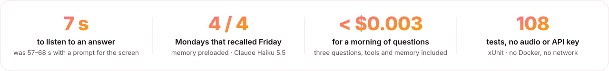
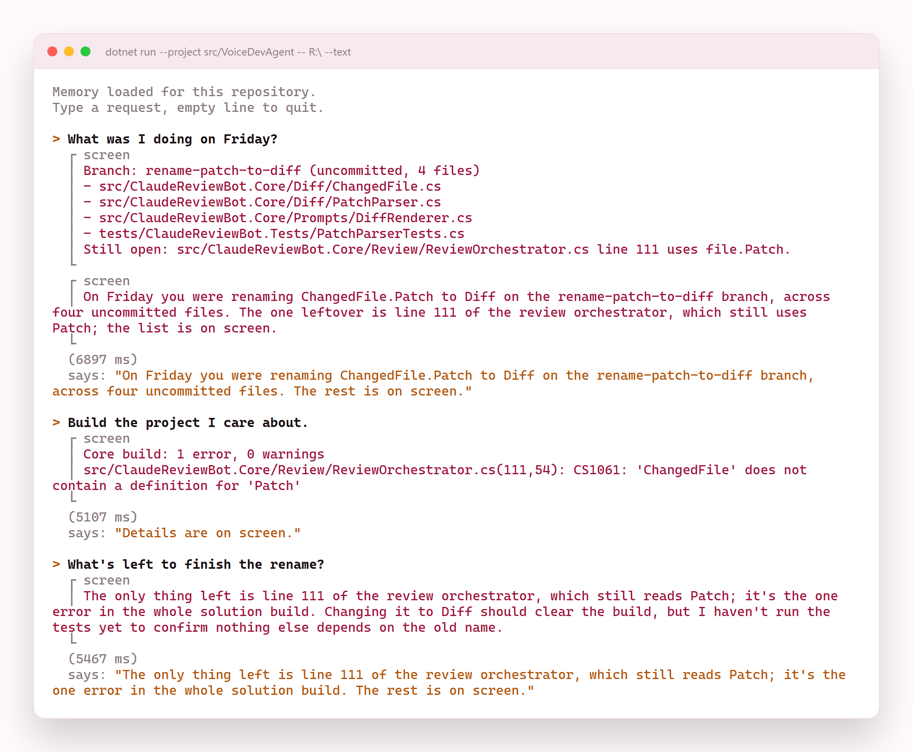
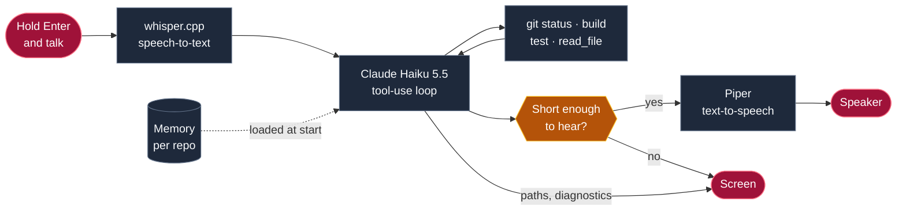

<div align="center">

<picture>
  <source media="(prefers-color-scheme: dark)" srcset="docs/readme/hero-dark.svg">
  
</picture>

<br><br>

<a href="https://github.com/Juxn89/dotnet-voice-dev-agent/actions/workflows/ci.yml"></a>


<a href="LICENSE"></a>

</div>

<br>

<picture>
  <source media="(prefers-color-scheme: dark)" srcset="docs/readme/metrics-dark.svg">
  
</picture>

<br><br>

Checking why the build is red, or which tests broke, means stopping what you are doing to read a
terminal. **dotnet-voice-dev-agent** lets you ask out loud: hold Enter, say *"why is the build red?"*, and
it runs the build, puts the diagnostics on screen and answers in a sentence or two. It remembers what you
tell it about each repository between sessions, and its tools are **read-only**, so a misheard request
can at worst start a build. Speech runs locally in Docker; the agent is Claude Haiku 5.5.

> [!NOTE]
> **Built in public, measured in public.** Every number on this page comes from the article series this
> repository accompanies, where each one was measured on this code:
> [Part 1: Teach It Your Actual Workflow](https://dev.to/jgomezdev/building-a-net-dev-agent-part-1-teach-it-your-actual-workflow-5826)
> ([en español](https://dev.to/jgomezdev/construye-un-agente-de-desarrollo-net-parte-1-ensenale-tu-flujo-de-trabajo-real-3580)),
> [Part 2: Give It a Voice](https://dev.to/jgomezdev/building-a-net-dev-agent-part-2-give-it-a-voice-1ef3)
> ([en español](https://dev.to/jgomezdev/construye-un-agente-de-desarrollo-net-parte-2-dale-voz-53an)),
> and [Part 3: Make It Remember You](https://dev.to/jgomezdev/building-a-net-dev-agent-part-3-make-it-remember-you-293e)
> ([en español](https://dev.to/jgomezdev/construye-un-agente-de-desarrollo-net-parte-3-haz-que-te-recuerde-2980)).
> The failures are in there too.

<p align="center">
  <picture>
    <source media="(prefers-color-scheme: dark)" srcset="docs/readme/showcase-dark.png">
    
  </picture>
</p>
<p align="center"><sub>A real Monday session from the Part 3 measurements: memory preloaded, Claude Haiku 5.5, typed requests. The requests, everything on screen, the spoken replies and the timings are copied from the run's capture; the window is the app's console format, drawn by <code>scripts/readme-assets.mjs</code>.</sub></p>

<p align="center"></p>

## How it works



1. **You hold Enter and talk.** The microphone records 16 kHz mono, the format Whisper wants, and a local
   whisper.cpp turns it into text. Every turn prints `heard: "..."`, because the transcript is often wrong.
2. **The agent checks before it answers.** Claude Haiku 5.5 runs the read-only tools it needs: `git status`,
   `dotnet build`, `dotnet test`, `read_file`. What it knows about your repository from earlier sessions is
   already in its prompt.
3. **Short answers go to your ear, the rest to the screen.** Paths, stack frames and lists go through
   `show_on_screen`; a reply over 30 words is moved to the screen in code, and only its first sentence is
   spoken by a local Piper voice.
4. **When it can't do its job, it says so.** A tool that fails, an API error or a turn that ends with
   nothing to say all become one short spoken sentence, and the session carries on.

## What's inside

<table>
  <tr>
    <td width="33%" valign="top">
      <br>
      <b>Push-to-talk</b><br>
      <sub>Enter to talk, Enter to stop, Enter again to cut a long answer off. No always-on microphone.</sub>
    </td>
    <td width="33%" valign="top">
      <br>
      <b>Local speech-to-text</b><br>
      <sub>whisper.cpp in Docker, with your project's vocabulary as its prompt. Silence never costs an API call.</sub>
    </td>
    <td width="33%" valign="top">
      <br>
      <b>Answers sized for the ear</b><br>
      <sub>Two sentences, diagnosis first. The 30-word limit is enforced in code, not only asked for.</sub>
    </td>
  </tr>
  <tr>
    <td width="33%" valign="top">
      <br>
      <b>Details on screen</b><br>
      <sub>A <code>show_on_screen</code> tool takes paths, errors and lists, so nothing precise is read aloud.</sub>
    </td>
    <td width="33%" valign="top">
      <br>
      <b>Memory per repository</b><br>
      <sub>Claude's memory tool, stored outside the repo, loaded into the prompt when a session starts.</sub>
    </td>
    <td width="33%" valign="top">
      <br>
      <b>Memory is checked, not trusted</b><br>
      <sub>A memory is a note from an earlier session; the agent checks it with a tool before repeating it.</sub>
    </td>
  </tr>
  <tr>
    <td width="33%" valign="top">
      <br>
      <b>read_file, fenced in</b><br>
      <sub>200 numbered lines at most, inside the repo. Refuses <code>.git</code>, <code>.env</code>, keys, links and binaries.</sub>
    </td>
    <td width="33%" valign="top">
      <br>
      <b>Read-only on purpose</b><br>
      <sub>No tool writes, commits or pushes. A misheard request can at worst run a build.</sub>
    </td>
    <td width="33%" valign="top">
      <br>
      <b>108 tests</b><br>
      <sub>The parsers, guards, WAV handling and the memory store, with no audio, Docker or API key.</sub>
    </td>
  </tr>
</table>

## Use it

You need the .NET 10 SDK, Docker, a microphone and headphones (laptop speakers feed the answer back into
the microphone), and an Anthropic API key in `ANTHROPIC_API_KEY`. Audio goes through
[PortAudioSharp2](https://www.nuget.org/packages/PortAudioSharp2), which ships PortAudio's native binaries
for Windows, Linux and macOS inside the package, so there is nothing else to install.

```bash
# 1. A Whisper model (tiny.en is the only one fast enough to talk to on a laptop CPU, see below)
curl -L -o models/ggml-tiny.en.bin https://huggingface.co/ggerganov/whisper.cpp/resolve/main/ggml-tiny.en.bin

# 2. Speech-to-text on :8080, text-to-speech on :5000
docker compose up -d

# 3. Point it at a .NET repository
export ANTHROPIC_API_KEY=...        # PowerShell: $env:ANTHROPIC_API_KEY = "..."
dotnet run --project src/VoiceDevAgent -- /path/to/your/repo
```

Enter starts listening, Enter stops. While it speaks, Enter cuts it off; after it finishes, Enter starts the
next request. `--text` swaps the microphone for the keyboard and keeps the voice:

```bash
dotnet run --project src/VoiceDevAgent -- /path/to/your/repo --text
```

To use a bigger model: `WHISPER_MODEL=base.en docker compose up -d` (after downloading `ggml-base.en.bin`).
[`models/README.md`](models/README.md) lists every model with its size and the download command for bash and
PowerShell.

### Make it yours

Tell it. "The core project is the one I care about", "CS1591 is noise": the agent saves facts like these to its
memory and loads them at the start of the next session. The memory is one folder per repository under your
local application data (`%LOCALAPPDATA%\VoiceDevAgent\memories` on Windows, `~/.local/share/VoiceDevAgent/memories`
on Linux), outside the repository so it is never committed. Read it, edit it, or delete the folder to make the
agent forget.

The `Vocabulary` constant in [`Program.cs`](src/VoiceDevAgent/Program.cs) is Whisper's initial prompt. Put your
project's type names, error codes and jargon there. It fixes exactly the words speech-to-text breaks most.

## Measured, not claimed

Measured on a 4-core laptop CPU with one speaker, the author, so read these as measured anecdotes, not
benchmarks. The articles have the full tables and the runs behind them; the measurement harness itself is not
in this repository.

| Measure | Result | Where it was measured |
|---|---:|---|
| Spoken answer to four failing tests, voice prompt | 6.5–7.2 s | Part 2, two runs |
| The same answer with a prompt written for the screen | 57.2–67.9 s | Part 2, same runs |
| From releasing Enter to the first spoken word | 7–12 s | Part 2, a real four-turn session |
| Mondays that said what was left from Friday, memory preloaded | 4 of 4 | Part 3, scripted Friday and Monday |
| Cost of a morning of three questions, tools and memory included | < $0.003 | Part 3, Claude Haiku 5.5 |
| Tokens the memory tool adds to every first request | 1,438 | Part 3, token-counting endpoint |

| Whisper model | Word error rate (with vocabulary prompt) | Median per sentence |
|---|---|---|
| `tiny.en` | 0.68 | 1.8 s |
| `base.en` | 0.59 | 5.6 s |
| `small.en` | 0.48 | 13.4 s |
| `large-v3-turbo` | 0.41 | over a minute |

What did not go well, measured on the same runs:

- **The transcript is often wrong, and the agent is built for that.** "Why is the build red?" arrived as "What
  is the view right?" and the agent still ran the build. When a transcript can mean two different actions, it
  asks.
- **The agent saves state it was told not to.** Four of four memories written on a Friday kept the build error
  and its line number. That is why a memory is checked with a tool before it is repeated, and even that rule
  is not a guarantee: five of eight Mondays still repeated a note without checking it.
- **English only, as configured.** The `.en` models do not reject other languages; they return fluent English
  you never said. Speaking Spanish needs a multilingual Whisper model and a Spanish Piper voice.

## Architecture and decisions

[`ARCHITECTURE.md`](ARCHITECTURE.md) has the full picture: the turn lifecycle, the error-handling table and the
infrastructure. The decisions that shape the code:

- **Two output channels.** The model's final text is spoken; `show_on_screen` takes paths, stack frames and
  lists. A reply over 30 words is moved to the screen in code, because the prompt asks for brevity but cannot
  guarantee it. A turn that ends with no text at all says "Details are on screen." instead of going silent.
- **Read-only tools on purpose.** A misheard request can at worst run a build. Before adding a tool with side
  effects, make it ask for confirmation in code, not in the prompt.
- **Memory is preloaded and frozen.** The memory goes into the system prompt when a session starts, which
  saves the round trip the memory tool otherwise spends viewing it, and the prompt never changes mid-session:
  that would discard the prompt cache and, on Haiku 5.5, invalidate the thinking blocks in the history.
- **The history only grows at the end.** A failed API request drops the whole turn, so a `tool_use` is never
  left without its `tool_result`, and the session date goes in the first message rather than in the prompt.
- **Everything the model sends is untrusted.** Project paths, file paths and memory paths are validated
  before they touch a process or the disk, and the memory store refuses text shaped like a credential.
- **The exit code is the verdict.** `RunAsync` returns it with the output, and a non-zero exit with no parsed
  error still reads as a failure.

## Development

```bash
dotnet build
dotnet test                         # no microphone, containers or API key needed
node scripts/readme-assets.mjs      # README artwork in docs/readme
```

The tests cover the logic that needs no audio or network: the summaries the tools return, silence detection,
the spoken-length guard, WAV handling, the validation of the model's tool arguments, `read_file`'s refusals
and the memory store. [`CHANGELOG.md`](CHANGELOG.md) lists what changed. The showcase PNGs are screenshots of
`docs/readme/showcase.html`, which the same script writes:

```bash
npx playwright@1.64.1 screenshot --device="Desktop Chrome HiDPI" --viewport-size=1100,600 --full-page \
  --color-scheme=dark file:///$PWD/docs/readme/showcase.html docs/readme/showcase-dark.png
```

## How it was built

With [Claude Code](https://claude.com/claude-code), in the open: [`CLAUDE.md`](CLAUDE.md) holds the commands
and invariants it works by, and [`.claude/skills`](.claude/skills) has the skills for this repository:
`/run-agent` (a smoke test with the real containers), `/add-tool` (adding a tool with its argument
validation), `/bump-images` (updating the pinned containers) and `/update-changelog`. The articles describe the
design decisions; this repository is the part you can run.

<p align="center"></p>

<div align="center">

**Juan Gómez** · [juangomezb.com](https://www.juangomezb.com) · [GitHub](https://github.com/Juxn89) · [LinkedIn](https://www.linkedin.com/in/jcgomez89/)

<sub>Released under the <a href="LICENSE">MIT License</a>.</sub>

</div>
